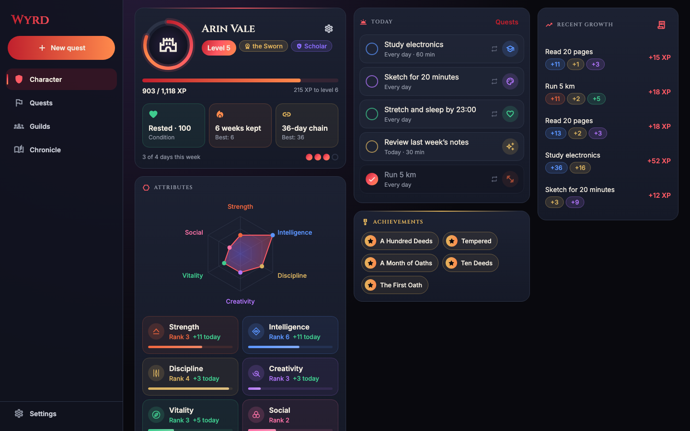
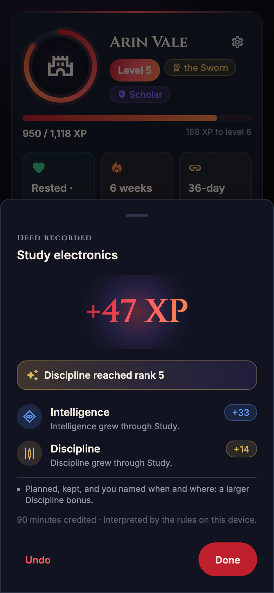
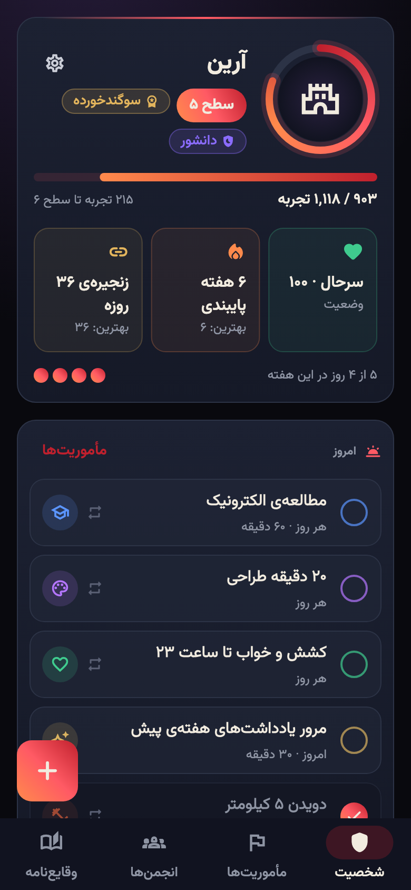
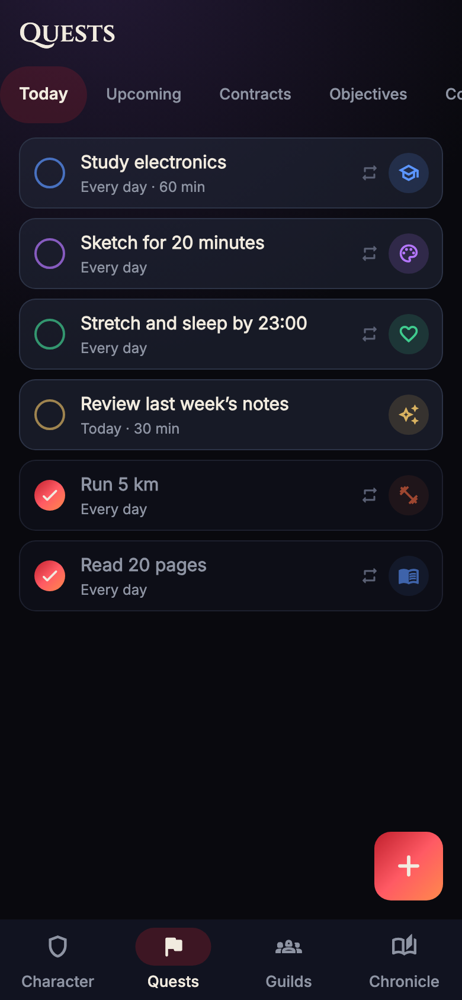
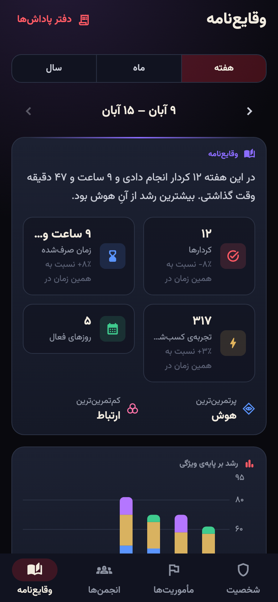
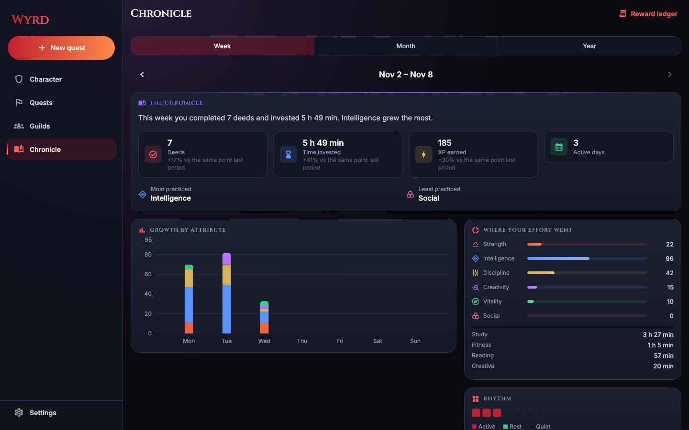

<div align="center">

# Wyrd

**Your character is not someone you play. Your character is who you become.**

A dark-fantasy RPG productivity ecosystem in which real-life effort shapes a persistent character,
its history, and the guilds it belongs to.

Android · iOS · Web (desktop browsers) — English & فارسی (full RTL) from day one

**[▶ Try the live web demo](https://alikahroodiee.github.io/wyrd/)** — runs in your browser with sample data; nothing leaves your device.

[](LICENSE.md)

</div>

<p align="center">
  
</p>

<table>
  <tr>
    <td align="center" width="25%"><br><sub>Every reward explains itself</sub></td>
    <td align="center" width="25%"><br><sub>Full Persian, right to left</sub></td>
    <td align="center" width="25%"><br><sub>Quests, habits and contracts</sub></td>
    <td align="center" width="25%"><br><sub>Chronicle in the Jalali calendar</sub></td>
  </tr>
</table>

<p align="center">
  
</p>

<sub>Screenshots are rendered from the real app with six weeks of demo data
(<code>flutter test --dart-define=SCREENSHOTS=true --update-goldens test/screenshots</code> in <code>app/</code>).</sub>

---

## What it is

Wyrd is a task and habit system wrapped in a serious, atmospheric RPG. You don't assign
yourself points. You do real things — study, train, build, reach out to people — and an AI
evaluator proposes how that effort should shape your character. A deterministic progression
engine then validates, caps and records every reward in an auditable ledger, and tells you
exactly why you grew.

| Pillar | What it means in the product |
| --- | --- |
| **Character** | Six attributes (Strength, Intelligence, Discipline, Creativity, Vitality, Social), levels, titles, emergent classes, a permanent chronicle. Attributes are never lost to inactivity. |
| **AI progression** | AI interprets each completed task; a deterministic engine caps, applies diminishing returns, and explains the result. AI never writes to your character directly. |
| **Quests** | Daily Quests → Contracts → Long-Term Objectives, with recurrence, subtasks, reminders and optional time tracking. |
| **Guilds** | Private and public guilds, an activity feed with reactions and comments, collective challenges that never punish members for one person's inactivity. |
| **Chronicle** | Weekly, monthly and yearly analytics, historical character snapshots, and AI-written chronicles grounded in your real data. |
| **Psychology** | Designed from published research on motivation, habit formation and self-compassion — no shame mechanics, no gambling loops, no streak terror. |

## Status

Milestones **M0 Foundation** and **M1 Connected** are implemented; M2–M4 (public guilds,
premium, store releases) are next.

| Area | State |
| --- | --- |
| Research, product spec, progression rules, design system, UX, architecture + ADRs | ✅ [`docs/`](docs/) |
| Progression engine in Dart (103 tests) and TypeScript (46 tests), bound by shared conformance vectors | ✅ |
| Local-first app: character sheet, quests (daily/contracts/objectives, recurrence, subtasks, timer, reminders), reward reveal with explanations, ledger, week/month/year chronicle, settings, onboarding | ✅ [`app/`](app/) |
| English + Persian, full RTL, Jalali/Gregorian, native/Latin digits, auto-direction for user text | ✅ |
| Adaptive layouts: phone (bottom bar), tablet (rail), desktop/web (sidebar, multi-column) | ✅ |
| Backend: schema, row-level security, sync and progression RPCs, Claude evaluation and chronicle functions, push notifications | ✅ [`backend/`](backend/) |
| Client accounts, sync, server evaluation, guilds (feed, reactions, comments, challenges) | ✅ |
| Bring your own AI: Anthropic, OpenAI, Google Gemini, or any Anthropic/OpenAI-compatible service (OpenRouter, Groq, Ollama…) | ✅ |

**Verified here:** all engine, app and backend test suites; static analysis; all migrations and
73 security/behaviour checks against an offline Postgres (PGlite); type-checks of every Edge
Function; the web build exercised in a browser in English and Persian at phone, tablet and
desktop widths.

**Not yet verified:** a live Supabase project, real Claude and FCM calls, and native builds for
Android and iOS (they need the Android SDK and Xcode). On desktop, Wyrd runs as a web app
in the browser and can be installed from it.
Persian copy needs review by a native speaker before release.

## Repository layout

```
.
├── app/            Flutter client (Android, iOS, Web)
├── packages/       Shared pure-Dart packages (the progression engine)
├── backend/        Supabase schema, row-level security, Edge Functions
└── docs/           Research, product spec, design system, architecture, ADRs
```

## Getting started

Prerequisites: Flutter 3.47+ (stable), Dart 3.13+, plus the toolchain for each target platform.

```bash
cd app
flutter pub get
flutter run -d chrome          # or an Android device / iOS simulator
```

Without backend configuration the app runs fully on the device (guest mode): every feature
except accounts, sync and guilds works offline. To try it with six weeks of sample activity:

```bash
flutter run -d chrome --dart-define=WYRD_DEMO=true                                  # English
flutter run -d chrome --dart-define=WYRD_DEMO=true --dart-define=WYRD_DEMO_LOCALE=fa # Persian
``` To connect a Supabase backend:

```bash
flutter run --dart-define=SUPABASE_URL=https://<project>.supabase.co --dart-define=SUPABASE_PUBLISHABLE_KEY=<publishable-key>
```

Backend setup is documented in [`backend/README.md`](backend/README.md).

## Hosting

| You want | You host |
| --- | --- |
| The app on phones, everything local (guest mode) | Nothing |
| The web app (desktop and mobile browsers) | Static files only: `flutter build web` → GitHub Pages, Cloudflare Pages, Netlify or Vercel |
| Accounts, sync across devices, guilds, push | The Supabase backend in [`backend/`](backend/) (Supabase Cloud or self-hosted) — see its README |

**AI is optional and can cost the operator nothing.** Each user can connect their own Anthropic,
OpenAI, Google Gemini or compatible account under *Settings → AI → Your own AI*. The key stays
on the user's device (platform secure storage) and goes only to that provider. Signed-in users'
AI proposals are sent to the server, which validates them and bounds difficulty and duration by
its own estimate before the rules engine grants anything. A server-side key
(`ANTHROPIC_API_KEY`) remains possible but is not required; without any AI, the built-in rules
evaluate every quest.

## Tests

```bash
cd packages/wyrd_engine && dart test     # rules, caps, curves, consistency, vectors
cd app && flutter test                        # data layer, l10n gates, RTL lint, smoke tests
cd app && flutter analyze --fatal-infos
```

CI runs all of these plus the web build on every push ([`.github/workflows/ci.yml`](.github/workflows/ci.yml)).

## Localization

English and Persian are first-class launch languages. All UI strings live in ARB resource files
with stable keys; layouts use logical (start/end) directions only. Adding a language is a
content task, not an engineering project — see [`docs/localization.md`](docs/localization.md).

## License

**Source-available, not open source in the OSI sense.** This code is published so you can read
it, learn from it, and evaluate it. It is licensed under the
[PolyForm Strict License 1.0.0](LICENSE.md), which in plain terms means:

- ✅ You may read the code and run it for personal, noncommercial study or experimentation.
- ❌ You may **not** redistribute it, in whole or in part.
- ❌ You may **not** modify it or build new works based on it.
- ❌ You may **not** use it for any commercial purpose.

For any other use — commercial licensing, partnerships, or permission to reuse part of the
code — contact the author through GitHub. The license text in [`LICENSE.md`](LICENSE.md) is
the binding document; this summary is not legal advice.

## Contributing

Because the license does not permit derivative works, pull requests cannot be accepted without
a separate written contributor agreement. Bug reports and suggestions are welcome as issues.
See [`CONTRIBUTING.md`](CONTRIBUTING.md).

Copyright © 2026 AliKahroodiEE. All rights not expressly granted are reserved.
